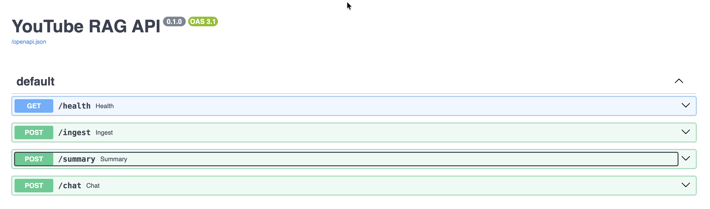
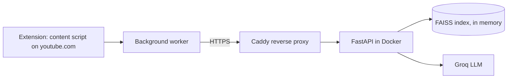

# YouTube RAG Assistant

A Chrome extension that adds a chat panel to YouTube. It can **summarize a video** and **answer questions about it**, with answers that link back to the exact moment in the video. It reads the transcript from the page, and a small backend does the retrieval and calls an LLM.

Built as a learning project: LangChain, RAG, FastAPI, Docker, CI, and deployment on AWS.




## Features

- Summary with key points and clickable timestamps (long videos use map-reduce)
- Streaming chat answers with `[m:ss]` citations that jump the video to that moment
- Follow-up questions (the last 10 messages are sent as history)
- Minimizable panel that follows YouTube's light and dark theme

## How it works



1. The content script reads the transcript from the YouTube page.
2. The backend splits it into time-aware chunks (about 1000 characters, 200 overlap), embeds them locally with `all-MiniLM-L6-v2`, and keeps a FAISS index per video.
3. For a question, it retrieves 10 candidates, reranks them with a cross-encoder (`ms-marco-MiniLM-L-6-v2`), and gives the best 5 to the LLM (`openai/gpt-oss-120b` on Groq), which must answer only from those excerpts.
4. Answers stream back as NDJSON. Summaries use structured output; long videos are summarized in batches and then merged.

## Retrieval quality

Measured on a hand-written set of 20 questions (with the time window where each answer lives) on one 51-minute video:

| Setup | Hit rate | MRR |
|---|---|---|
| 1000-char chunks, top 5 (baseline) | 0.95 | 0.718 |
| top 10 | 1.00 | 0.727 |
| 500-char chunks, top 5 | 0.95 | 0.739 |
| 1500-char chunks, top 5 | 1.00 | 0.760 |
| **1000-char chunks + reranker (10 candidates)** | **1.00** | **0.942** |

The reranker is on by default. Caveats: 20 questions on one video is a small sample, and a "hit" is any overlap with the answer window, which is lenient.

## Run it locally

```bash
python -m venv .venv && source .venv/bin/activate
pip install -r backend/requirements-dev.txt
cp .env.example .env        # then put your GROQ_API_KEY in .env
cd backend
python -m uvicorn app.main:app --reload --port 8000
```

Tests (offline, no API key needed): `cd backend && python -m pytest -q`

To use the extension against your local backend, set `API_BASE` in `extension/background.js` to `http://localhost:8000` and add that address to `host_permissions` in `extension/manifest.json`, then load the `extension/` folder with **Load unpacked** in `chrome://extensions`.

## Docker

```bash
cd backend
docker build -t yt-rag-backend .
docker run --rm -p 8000:7860 --env-file ../.env yt-rag-backend
```

## Deployment

- GitHub Actions runs the tests and lint, builds the image, smoke-tests `/health`, and pushes it to Docker Hub on every push to `main`.
- The image runs on an AWS EC2 Ubuntu instance behind Caddy, which provides HTTPS automatically.
- The server is switched on only for demos. To update it: `docker pull`, then re-create the container.

## Install the extension

Download the zip from the [Releases](../../releases) page, unzip it, open `chrome://extensions`, enable **Developer mode**, and choose **Load unpacked**.

## Limitations

- Reads the transcript from YouTube's page structure, which is unofficial and may break when YouTube changes its layout.
- Uses a shared free-tier Groq key, so a long summary can take minutes because of rate limits.
- Transcripts live in the server's memory only (up to 20 videos) and are lost on restart.
- "List everything mentioned" questions are a known weakness of retrieval-based answers.
- The demo server is off by default.

## Privacy

See [PRIVACY.md](PRIVACY.md).